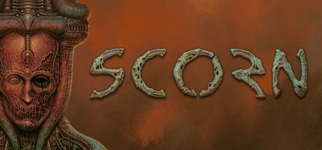

**Scorn is a first-person horror puzzle game set in an alien biomechanical world inspired by H.R. Giger and Zdzisław Beksiński, where a nameless being struggles through grotesque organic environments with no explanation or guidance.**

---

## 📖 About

Scorn is a first-person horror puzzle game set in an alien biomechanical world inspired by H.R. Giger and Zdzisław Beksiński, where a nameless being struggles through grotesque organic environments with no explanation or guidance.

## ⚠️ Problems Without Trainer

| Problem | Status |
|---------|--------|
| **No Guidance** — The game provides absolutely zero explanation for systems, objectives, or story | ✅ Solved |
| **Ammo Scarcity** — Each weapon type has extremely limited ammunition requiring conservation | ✅ Solved |
| **Puzzle Obscurity** — Environmental puzzles require lateral thinking with zero hints provided | ✅ Solved |
| **Body Horror** — Graphic biological content is intentionally disturbing and off-putting | ✅ Solved |

## ✅ Solution

The **Scorn Trainer** solves all these issues by giving you complete control over the game.

## 🎯 Full Feature List

- Unlimited Resources
- God Mode / Invincibility
- Instant Skill Cooldown
- One-Hit Kill
- Freeze Game Timer
- Unlock All Items & Achievements
- Custom Speed Multiplier
- Save State Anywhere

## 🚀 Quick Start

1. **Disable Windows Defender** temporarily (trainer may trigger false positive)
2. Download the trainer from the button above
3. Launch Scorn
4. Run the trainer as Administrator
5. Activate desired cheats with hotkeys

## 💎 Free vs Paid

| Feature | Free | Pro |
|---------|------|-----|
| Basic God Mode | ✅ | ✅ |
| Unlimited Resources | ✅ | ✅ |
| All Advanced Cheats | ❌ | ✅ |
| Auto-Updates | ❌ | ✅ |
| Priority Support | ❌ | ✅ |

## 💻 Requirements

- Windows 10/11 (64-bit)
- Scorn (any version)
- .NET Framework 4.8+
- DirectX 11+

## 🍎 macOS

macOS users can use our alternative tool:

## ⚖️ Legal

This trainer is for educational and single-player use only. Use responsibly.

---

